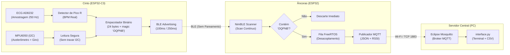

# Sistema de Monitoramento IoT: Cinto BLE, Âncoras ESP32 e Broker MQTT

Este projeto implementa uma arquitetura completa de telemetria corporal e localização relativa por proximidade utilizando dois nós IoT:
- **Cinto Inteligente (ESP32-C3):** Coleta dados de movimento (MPU6050) e atividade cardíaca com cálculo de batimentos por minuto em tempo real (ECG AD8232), transmitindo tudo via pacotes de anúncio Bluetooth Low Energy (BLE Advertising).
- **Âncoras de Monitoramento (ESP32):** Escutam continuamente os rádios BLE do ambiente, filtram exclusivamente os dispositivos contendo a assinatura de segurança **`OQPNB`**, extraem os dados dos sensores e o nível de sinal (RSSI), e transmitem via Wi-Fi para um Broker MQTT (Eclipse Mosquitto).
- **Interface Central (Python):** Assina os tópicos do broker, decodifica as leituras, armazena em CSV e determina a proximidade do usuário em relação a cada âncora instalada.

---

## 1. Arquitetura e Fluxo de Dados



---

## 2. Como os Códigos Funcionam

### 2.1. Cinto (`cinto_v3.ino`)

1. **Amostragem e Cálculo de BPM Real (250 Hz):**
   - Coleta o sinal analógico em `A0` a cada $4000\,\mu\text{s}$.
   - Aplica um filtro passa-alta leve ($\sim 0.6\,\text{Hz}$) para remover flutuação de linha de base e respiração.
   - Aplica filtro passa-baixa ($\sim 40\,\text{Hz}$) para filtrar ruídos da rede elétrica.
   - Utiliza um **detector de pico R adaptativo**: o limiar acompanha o envelope do sinal. A detecção possui período refratário de $250\,\text{ms}$ para evitar disparos falsos e só aceita intervalos RR fisiológicos ($30$ a $200\,\text{BPM}$).
   - O BPM é calculado pela mediana dos últimos $5$ intervalos RR:
     $$\text{BPM} = \frac{60000}{\text{mediana}(RR)}$$
   - Se os eletrodos se soltarem (`lop`/`lom` em nível alto) ou não houver batimentos por mais de $3$ segundos, o cinto sinaliza a flag de erro e zera o BPM.

2. **Leitura I2C do MPU6050:**
   - Comunicação configurada com timeout de hardware de $100\,\text{ms}$, garantindo que falhas físicas ou mau contato não travem a CPU.

3. **Pacote Binário BLE (24 bytes):**
   Para contornar o limite rígido de $31$ bytes do BLE Advertising sem truncar texto, os dados são enviados em formato binário compacto no campo *Manufacturer Data* (após o Company ID `0xFFFF`):

   | Offset | Tamanho | Campo | Descrição |
   |:---|:---:|:---|:---|
   | `0` | 5B | `magic` | Assinatura ASCII `"OQPNB"` |
   | `5` | 1B | `versao` | Versão do protocolo (`2`) |
   | `6` | 1B | `beltNum` | Identificador do cinto (`1`) |
   | `7` | 1B | `seq` | Contador sequencial (`0` a `255`) |
   | `8` | 2B | `ax` | Aceleração X em mili-$g$ (int16) |
   | `10` | 2B | `ay` | Aceleração Y em mili-$g$ (int16) |
   | `12` | 2B | `az` | Aceleração Z em mili-$g$ (int16) |
   | `14` | 2B | `gx` | Giroscópio X em $0.1^\circ/\text{s}$ (int16) |
   | `16` | 2B | `gy` | Giroscópio Y em $0.1^\circ/\text{s}$ (int16) |
   | `18` | 2B | `gz` | Giroscópio Z em $0.1^\circ/\text{s}$ (int16) |
   | `20` | 1B | `bpm` | Batimentos por minuto reais (uint8) |
   | `21` | 1B | `flags` | Bit 0: eletrodos soltos; Bit 1: erro MPU; Bit 2: BPM válido |
   | `22` | 2B | `ecg` | Amostra bruta filtrada do ADC (uint16) |

   > **Scan Response:** O nome do dispositivo (`CINTO_OQPNB01`) é transmitido via *Scan Response*, garantindo que tanto receptores passivos quanto ativos consigam identificar a chave `"OQPNB"`.

---

### 2.2. Âncora (`anchor_v3.ino`)

1. **Recepção e Filtragem NimBLE:**
   - Opera em modo de varredura contínua ativa (`setActiveScan(true)`).
   - O callback de evento inspeciona cada dispositivo na sala: se não contiver `"OQPNB"` no nome ou nos dados de fabricante, é descartado instantaneamente sem consumo de memória.
2. **Desacoplamento por Fila FreeRTOS:**
   - As leituras válidas são colocadas em uma `QueueHandle_t`. Isso evita publicar no MQTT dentro do contexto de interrupção do rádio BLE, prevenindo *panics* e travamentos do ESP32.
3. **Encaminhamento MQTT:**
   - O `loop()` retira os dados da fila e publica um JSON completo no tópico `oqpnb/anchor/<ANCHOR_ID>`.
   - Inclui o Last Will and Testament (LWT) no tópico `oqpnb/anchor/<ANCHOR_ID>/status` marcando `"online"` ou `"offline"`.

Exemplo de payload JSON publicado:
```json
{
  "anchor": 1,
  "belt": "CINTO_OQPNB01",
  "belt_num": 1,
  "mac": "34:85:18:ab:cd:ef",
  "rssi": -62,
  "seq": 142,
  "ax": 0.012,
  "ay": -0.035,
  "az": 0.988,
  "gx": -1.2,
  "gy": 0.4,
  "gz": 0.0,
  "bpm": 74,
  "bpm_valid": true,
  "ecg": 2045,
  "leads_off": false,
  "mpu_error": false,
  "ms": 583200
}
```

---

### 2.3. Interface de Monitoramento (`interface.py`)

- Conecta-se ao broker Mosquitto e subscreve o tópico `oqpnb/anchor/#`.
- Exibe cada leitura formatada no terminal com indicativos de alerta (`[ELETRODOS SOLTOS]`, `[ERRO MPU]`).
- Gera periodicamente uma tabela com o **RSSI médio** de cada par Cinto $\times$ Âncora e calcula automaticamente qual âncora está mais próxima do usuário.
- Suporta gravação contínua em formato CSV para posterior análise estatística ou plotagem de gráficos.

---

## 3. Configurações Necessárias para Operação

Para que todo o sistema funcione, siga o roteiro de configuração abaixo.

### 3.1. Configuração do Broker Mosquitto (Windows)

Por padrão, o Mosquitto só permite conexões originadas no próprio computador (`localhost`). É obrigatório liberar a escuta externa.

1. Instale o [Eclipse Mosquitto](https://mosquitto.org/download/) (instalador x64 para Windows).
2. Abra o arquivo de configuração com permissões de administrador:
   ```text
   C:\Program Files\mosquitto\mosquitto.conf
   ```
3. Adicione as seguintes duas linhas ao final do arquivo:
   ```conf
   listener 1883 0.0.0.0
   allow_anonymous true
   ```
4. Salve o arquivo e reinicie o serviço no PowerShell (como Administrador):
   ```powershell
   Restart-Service mosquitto
   ```

### 3.2. Regra de Firewall do Windows 11

Libere a porta TCP 1883 para tráfego de entrada executando no PowerShell como Administrador:
```powershell
New-NetFirewallRule -DisplayName "Mosquitto MQTT 1883" -Direction Inbound -Protocol TCP -LocalPort 1883 -Action Allow -Profile Private,Domain
```

> [!IMPORTANT]
> Certifique-se de que sua rede Wi-Fi está marcada como **Rede Privada** no Windows (*Configurações > Rede e Internet > Wi-Fi > [Sua Rede] > Tipo de perfil: Privada*). O Windows Defender bloqueia portas externas em redes marcadas como Públicas.

### 3.3. Configuração dos Códigos das Âncoras (`anchor_v3.ino`)

Descubra o IP do computador onde o Mosquitto está rodando executando `ipconfig` no terminal (localize o IPv4 do adaptador Wi-Fi, ex: `192.168.1.105`).

Edite as seguintes linhas no topo do arquivo `anchor_v3/anchor_v3.ino`:

```cpp
#define ANCHOR_ID 1                    // Identificador desta âncora (1, 2, 3...)
#define WIFI_SSID     "NOME_DO_SEU_WIFI"
#define WIFI_PASSWORD "SENHA_DO_SEU_WIFI"
#define MQTT_BROKER   "192.168.1.105"  // IP do PC com o Mosquitto
#define MQTT_PORT     1883
```

> [!TIP]
> Ao gravar múltiplas âncoras na mesma sala, altere apenas `#define ANCHOR_ID` para `2`, `3`, etc., em cada placa.

### 3.4. Execução da Interface Central (Python)

1. Instale o pacote `paho-mqtt` no terminal:
   ```powershell
   pip install paho-mqtt
   ```
2. Execute o monitor (se estiver no mesmo computador do broker):
   ```powershell
   python interface.py --csv leituras.csv
   ```
3. Se estiver rodando o script em outro computador na mesma rede:
   ```powershell
   python interface.py --broker 192.168.1.105 --csv leituras.csv
   ```

Opções de linha de comando disponíveis:
- `--broker <IP>`: Endereço do broker (padrão: `localhost`).
- `--port <PORTA>`: Porta TCP (padrão: `1883`).
- `--csv <ARQUIVO>`: Caminho para gravação contínua em arquivo CSV.
- `--summary <SEG>`: Intervalo de atualização da tabela de proximidade RSSI (padrão: `5.0`).
- `--quiet`: Oculta a listagem contínua pacote a pacote, exibindo apenas o resumo de proximidade.
