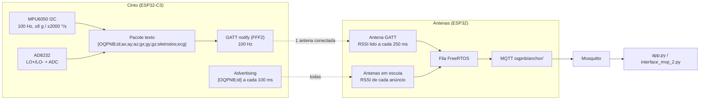

# Firmware do Cinto Inteligente — cinto_mvp_v1 e anchor_mvp_v1

Dois sketches Arduino (ESP32) formam a camada de hardware do MVP:

| Pasta | Placa | Função |
|---|---|---|
| `cinto_mvp_v1/` | ESP32-C3 | Lê MPU6050 (±8 g / ±2000 °/s) a 100 Hz e o AD8232 (ECG + eletrodos). Envia as leituras cruas por **GATT** para uma antena e, ao mesmo tempo, **anuncia por BLE** para as demais medirem RSSI. |
| `anchor_mvp_v1/` | ESP32 | Modo híbrido: conecta por GATT ao cinto (uma antena por vez) e/ou escuta os anúncios (todas). Repassa tudo por **Wi‑Fi/MQTT** ao broker Mosquitto. |
| `libraries/` | — | Bibliotecas usadas pelo firmware: NimBLE-Arduino 2.5.2 (cinto e antena) e PubSubClient 2.8 (antena). Copie para `Documentos\Arduino\libraries` ou instale as mesmas versões pelo Gerenciador de Bibliotecas da Arduino IDE. |

O PC consome os tópicos MQTT com `app.py` (painel) ou `interface_mvp_2.py` (terminal), na raiz do repositório.
O passo a passo completo de instalação (Arduino IDE, pacote ESP32, drivers USB e gravação) está no
manual, em `DOCUMENTACAO/Manual_Usuario_Operacao.pdf` (Seção 3.2).

## Fluxo de dados



## Protocolo

### Advertising (todas as antenas medem RSSI)
Manufacturer Data com o texto `{OQPNB;<id_cinto>}`.
- Sem GATT: anúncio **conectável**, intervalo 20–40 ms (reconexão rápida).
- Com GATT ativo: anúncio **não conectável**, a cada 100 ms (beacon só para RSSI).

### GATT (uma antena recebe os sensores)
- Serviço `FFF0`; característica `FFF1` (write): a antena escreve o `CODIGO_AMBIENTE`; o cinto só transmite após validar.
- Característica `FFF2` (notify), 100 Hz, texto:
  `{OQPNB;id_cinto;ax;ay;az;gx;gy;gz;eletrodos_conectados;sinal_ad8232}`
  - `ax..gz`: int16 brutos do MPU (±8 g → 4096 LSB/g; ±2000 °/s → 16,4 LSB/(°/s)).
  - `eletrodos_conectados`: 1 = ambos conectados, 0 = algum solto (LED acende).
  - `sinal_ad8232`: ADC 0–4095.

### MQTT (publicado pela antena)
- Tópico `oqpnb/anchor/<ID_ANTENA>`, payload texto:
  - com GATT: `{OQPNB;id_antena;rssi;id_cinto;ax;ay;az;gx;gy;gz;eletrodos;ecg}`
  - só anúncio: `{OQPNB;id_antena;rssi;id_cinto;;;;;;;;}` (campos de sensores vazios)
- Tópico `oqpnb/anchor/<ID_ANTENA>/status`: `online` / `offline` (retido, com Last Will).

`interface_mvp_2.parse_pacote_mvp()` aceita também a variante com `seq` após `id_cinto` (13 campos).

## Como a antena decide GATT × escuta
- Toda antena começa escutando. Se vê o anúncio do cinto **conectável** (ninguém conectado), tenta conectar.
- Quem conecta valida o código do ambiente, assina `FFF2` e passa a repassar sensores + RSSI; enquanto conectada não escuta anúncios.
- Se a conexão cai, volta a escutar e o cinto volta a anunciar conectável; a primeira antena que conseguir reconecta.
- As demais seguem enviando apenas RSSI do anúncio.

## Configuração antes de gravar

**`anchor_mvp_v1.ino`** (topo do arquivo):
```cpp
#define CODIGO_AMBIENTE "OQPNB"   // igual ao do cinto
#define ID_ANTENA       1         // 1, 2, 3 (uma por placa)
#define WIFI_SSID       "..."
#define WIFI_PASSWORD   "..."
#define MQTT_BROKER     "192.168.x.x"   // IP do PC com o Mosquitto
#define MQTT_PORT       1883
```
O sketch vem com a rede Wi-Fi e o IP do laboratório da equipe (versão de apresentação); troque pelos da sua rede.

**`cinto_mvp_v1.ino`**:
```cpp
#define CODIGO_AMBIENTE "OQPNB"
#define ID_CINTO        1
#define FREQ_LEITURA_HZ 100       // precisa bater com o fs do modelo
// pinos: LO- = 2, LO+ = 3, ADC AD8232 = 4, LED = 10; MPU no I2C padrão (SDA 8, SCL 9, 0x68)
```

As faixas do MPU (`iniciarMPU()`: ±8 g / ±2000 °/s) **precisam ser as mesmas do modelo** em `modelos/`.
Se mudar, retreine com `scripts/treino_sisfall.py --faixa-acc ... --faixa-giro ...`.

## Broker Mosquitto (Windows)
1. Em `C:\Program Files\mosquitto\mosquitto.conf` adicione:
   ```conf
   listener 1883 0.0.0.0
   allow_anonymous true
   ```
2. `Restart-Service mosquitto` (PowerShell como administrador).
3. Libere a porta: `New-NetFirewallRule -DisplayName "Mosquitto MQTT 1883" -Direction Inbound -Protocol TCP -LocalPort 1883 -Action Allow -Profile Private,Domain`
4. A rede Wi‑Fi precisa estar como **Rede privada** no Windows.

## Diagnóstico pelo Serial (115200)
- Antena: a cada 5 s imprime `Modo: GATT+SENSORES | SCAN_RSSI`, RSSI, contadores RX GATT / RX Adv / TX MQTT e estado do Wi‑Fi/MQTT.
- Cinto: imprime quando a antena conecta, valida o código e quando o anúncio alterna entre conectável e beacon.

## Observações medidas (ver `dados/ensaios_rssi/`)
- A antena em GATT lê o RSSI da conexão a cada 250 ms; as em escuta, a cada anúncio recebido.
- Com Wi‑Fi e BLE no mesmo rádio e scan ativo, as antenas em escuta recebem ~1,4 anúncios/s dos 10/s enviados. Scan passivo (`setActiveScan(false)`) é a mudança candidata para melhorar isso.
- O tronco atenua ~22 dB o sinal para a antena às costas do usuário; isso limita a trilateração por RSSI (ver `README.md` da raiz).
