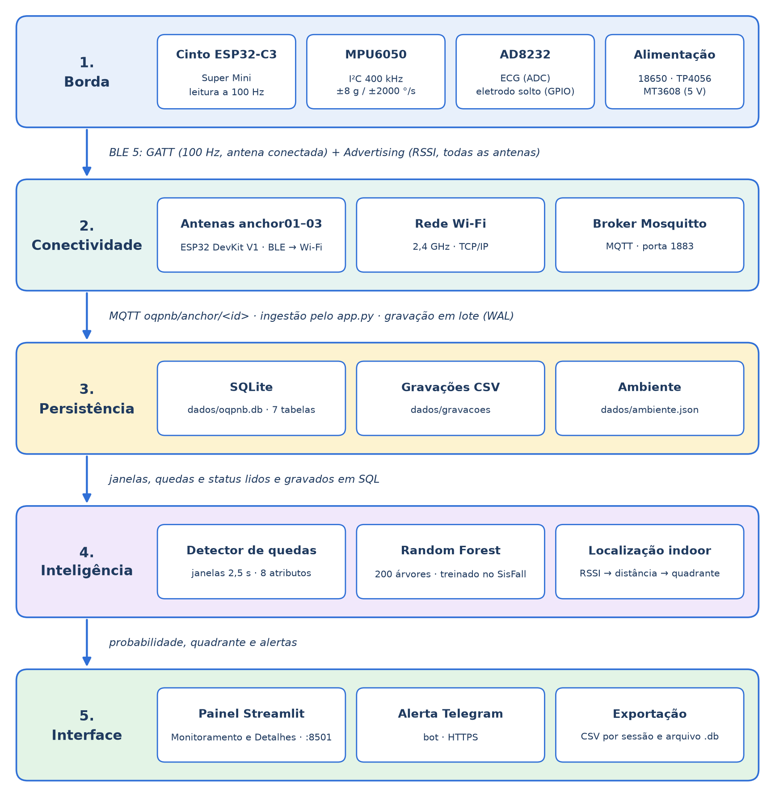
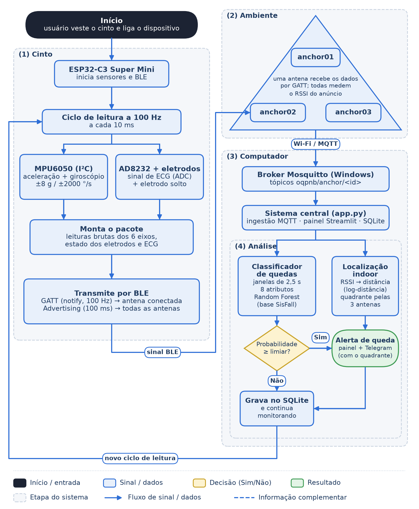
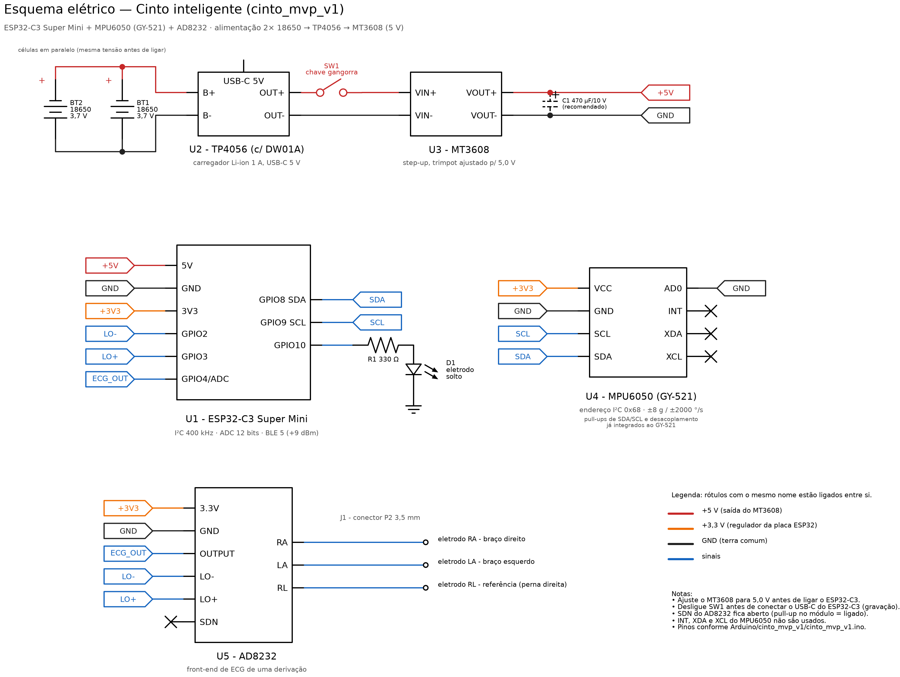
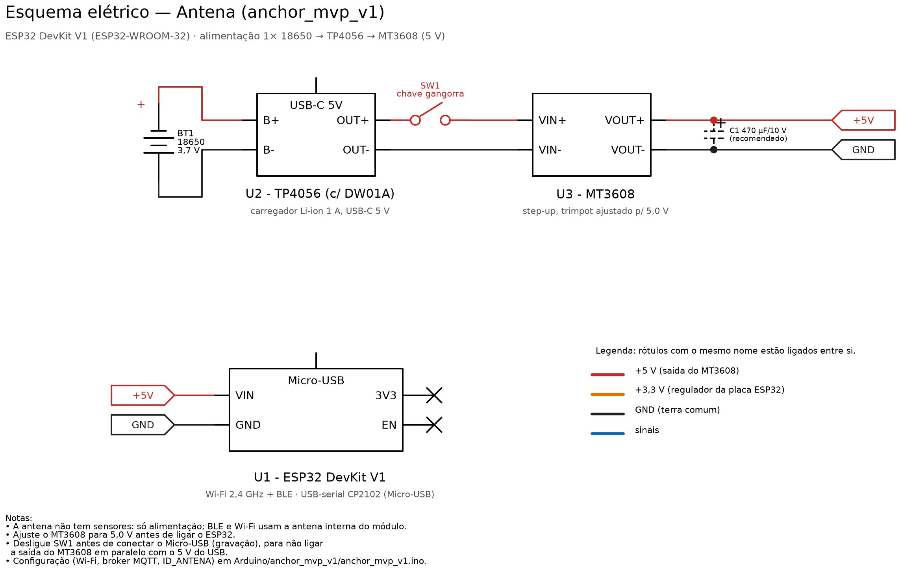

# Guia do Usuário e Manual de Operação — Cinto Inteligente OQPNB

---

## Seção 1 — Identificação do Ecossistema e Vertente

### 1.1 Identificação

| Item | Descrição |
|---|---|
| **Título da solução** | Cinto Inteligente com IoT e Inteligência Artificial para Monitoramento de Atividades, Sinais Vitais e Localização Indoor — Sistema de Detecção de Possíveis Quedas (OQPNB) |
| **Vertente** | **SmartCity — Cidades Inteligentes e Infraestrutura Urbana** |
| **Instituição / curso** | Universidade Paulista (UNIP) — Bacharelado em Ciência da Computação |
| **Orientador** | Prof. Marco Gomes |
| **Ano** | 2026 |

**Equipe executora**

| Integrante | RA | Função no projeto |
|---|---|---|
| Aluisio Pereira Alves | N135891 | Pesquisador e redator |
| Enzo Orlandi Gomes | G788EJ5 | Responsável pelo sistema embarcado |
| Erick de Brito Carvalho | G78HED3 | Arquiteto de soluções e desenvolvedor de software |
| Kayky Crespo dos Santos | G839226 | Product Owner, gerente de projeto e Scrum Master |

### 1.2 Enquadramento na vertente SmartCity

O sistema se insere no domínio de **saúde conectada da cidade inteligente**: uma rede local de sensores IoT monitora pessoas idosas em ambientes internos (residências, casas de repouso e unidades de saúde) sem câmeras, e reduz o tempo entre uma possível queda e a percepção de quem acompanha a pessoa. O ecossistema segue o padrão de infraestrutura urbana conectada: nós sensores de borda, rede de coleta (BLE + Wi-Fi), transporte padronizado (MQTT), persistência e um serviço de inteligência que dispara alertas para a rede de cuidado (Telegram).

**Problema atacado:** a demora em perceber uma queda de pessoa idosa que vive ou permanece sozinha em ambiente interno.

**Hipótese orientadora:** um cinto com sensor inercial na cintura, classificado por Random Forest treinado em dataset público, detecta possíveis quedas com alta sensibilidade e, combinado às antenas BLE, informa a região aproximada do ambiente onde a queda ocorreu.

### 1.3 Diagrama de arquitetura de alto nível

**Figura 1 – Arquitetura do ecossistema em camadas**



Fonte: elaborado pelos autores (2026).

| Camada | Componentes | Protocolos |
|---|---|---|
| Borda | Cinto (ESP32-C3, MPU6050, AD8232) | I²C (MPU), ADC e GPIO (AD8232) |
| Conectividade | 3 antenas ESP32, roteador Wi-Fi, Mosquitto | BLE 5 (GATT + Advertising), Wi-Fi 802.11 b/g/n 2,4 GHz, TCP/IP, MQTT 3.1.1 |
| Inteligência | `detector_queda.py`, `features.py`, `localizacao.py`, modelo `modelos/modelo_mvp_8g.joblib` | — |
| Persistência | SQLite (`banco.py`), CSV | SQL |
| Interface | Painel Streamlit (`app.py`), bot do Telegram (`alerta_telegram.py`) | HTTP (navegador), HTTPS (API do Telegram) |

### 1.4 Fluxo de funcionamento

A Figura 2 mostra o caminho de um ciclo de leitura, do sensor no cinto até o alerta.

**Figura 2 – Fluxograma do funcionamento completo do sistema**



Fonte: elaborado pelos autores (2026). Gerado por `DOCUMENTACAO/esquemas/gerar_fluxograma.py`.

---

## Seção 2 — Manual de Instalação e Montagem do Hardware

O conjunto tem **1 cinto** e **3 antenas** idênticas (`anchor01`, `anchor02`, `anchor03`).

### 2.1 Lista de materiais (BOM)

**Cinto (1 unidade)**

| Qtd | Componente | Modelo / part number | Tensão de operação | Função no circuito |
|---|---|---|---|---|
| 1 | Microcontrolador | ESP32-C3 Super Mini (Espressif ESP32-C3, RISC-V, Wi-Fi + BLE 5) | 5 V no pino 5V (regulador interno para 3,3 V) | Lê os sensores a 100 Hz e transmite por BLE |
| 1 | Sensor inercial | MPU6050 (módulo GY-521) | 3,3 V | Aceleração e velocidade angular (±8 g / ±2000 °/s) |
| 1 | Front-end de ECG | AD8232 (módulo SparkFun ou equivalente) + cabo P2 (3,5 mm) de 3 vias | 3,3 V | Sinal de ECG e detecção de eletrodo solto |
| 3 | Eletrodos | Eletrodo descartável de ECG com gel (Ag/AgCl), encaixe de pressão | — | Contato com a pele (RA, LA, RL) |
| 1 | Carregador de bateria | TP4056 com proteção (DW01A), entrada USB-C | 5 V de entrada; 4,2 V de corte | Carrega as baterias e as protege |
| 1 | Conversor elevador | MT3608 (step-up) | Entrada 2–24 V; saída ajustada para 5,0 V | Eleva 3,7 V das baterias para 5 V |
| 2 | Bateria | Li-ion 18650, 3,7 V, 1000 mAh cada, em paralelo (2000 mAh no total) | 3,0–4,2 V | Alimentação portátil |
| 1 | Chave | Mini chave gangorra (KCD11 ou equivalente) | — | Liga/desliga |
| 1 | LED + resistor (opcional) | LED 3 mm + resistor 330 Ω | 3,3 V | Indica eletrodo solto (GPIO 10 no firmware; não aparece na montagem atual da Figura 3) |
| 1 | Caixa | Case impresso em 3D (base + tampa) | — | Proteção e fixação no cinto |
| 2–4 | Insertos e parafusos | Rosca de latão M3 + parafuso M3 | — | Fixação da tampa |
| — | Fios | Fio de cobre flexível (vermelho/preto para energia; cores diversas para sinal) | — | Ligações soldadas |

**Antena (por unidade; montar 3)**

| Qtd | Componente | Modelo / part number | Tensão de operação | Função no circuito |
|---|---|---|---|---|
| 1 | Microcontrolador | ESP32 DevKit V1 (ESP32-WROOM-32, conversor USB-serial CP2102, Micro-USB) | 5 V no pino VIN | Recebe BLE do cinto, mede RSSI e publica por Wi-Fi/MQTT |
| 1 | Carregador de bateria | TP4056 com proteção, USB-C | 5 V de entrada | Carrega a bateria |
| 1 | Conversor elevador | MT3608 | Saída ajustada para 5,0 V | Eleva 3,7 V para 5 V |
| 1 | Bateria | Li-ion 18650, 3,7 V, 1000 mAh | 3,0–4,2 V | Alimentação portátil |
| 1 | Chave | Mini chave gangorra | — | Liga/desliga |
| 1 | Caixa | Case impresso em 3D com tampa perfurada e identificação gravada | — | Proteção e fixação |
| 2 | Insertos e parafusos | Rosca de latão M3 + parafuso M3 | — | Fixação da tampa |
| — | Fios | Fio de cobre | — | Ligações soldadas |

**Infraestrutura**

| Qtd | Item | Observação |
|---|---|---|
| 1 | Computador central | Windows 10/11 64 bits; executa broker, backend e painel |
| 1 | Roteador ou ponto de acesso Wi-Fi | Rede de **2,4 GHz** (o ESP32 não opera em 5 GHz) |
| 1 | Cabo USB-C (dados) | Gravação do cinto |
| 1 | Cabo Micro-USB (dados) | Gravação das antenas |

### 2.2 Pinagem (pinout)

**Cinto — ESP32-C3 Super Mini ↔ periféricos** (definida em `Arduino/cinto_mvp_v1/cinto_mvp_v1.ino`)

| Pino do ESP32-C3 | Pino do periférico | Sinal | Observação |
|---|---|---|---|
| 3V3 | MPU6050 VCC | Alimentação 3,3 V | |
| GND | MPU6050 GND | Terra | |
| GPIO 8 | MPU6050 SDA | Dados I²C | I²C padrão do ESP32-C3 (`Wire.begin()` sem argumentos), 400 kHz |
| GPIO 9 | MPU6050 SCL | Clock I²C | Endereço do MPU: `0x68` (AD0 em GND) |
| 3V3 | AD8232 3.3V | Alimentação 3,3 V | |
| GND | AD8232 GND | Terra | |
| GPIO 4 (ADC) | AD8232 OUTPUT | Sinal de ECG analógico | ADC de 12 bits (0–4095) |
| GPIO 2 | AD8232 LO− | Eletrodo solto (−) | Entrada digital |
| GPIO 3 | AD8232 LO+ | Eletrodo solto (+) | Entrada digital |
| GPIO 10 | LED (ânodo, via resistor de 330 Ω) | Indicador | Aceso = eletrodo solto (opcional) |
| 5V | MT3608 VOUT+ | Alimentação 5 V | |
| GND | MT3608 VOUT− | Terra comum | |

**Cinto — alimentação**

| Origem | Destino |
|---|---|
| Baterias 18650 (+), em paralelo | TP4056 B+ |
| Baterias 18650 (−) | TP4056 B− |
| TP4056 OUT+ | Chave gangorra (terminal 1) |
| Chave gangorra (terminal 2) | MT3608 VIN+ |
| TP4056 OUT− | MT3608 VIN− |
| MT3608 VOUT+ (5,0 V) | ESP32-C3 5V |
| MT3608 VOUT− | ESP32-C3 GND |
| Cabo P2 dos eletrodos | Conector de 3,5 mm do AD8232 (RA, LA, RL) |

**Antena — ESP32 DevKit V1**

A antena não tem sensores; só precisa de alimentação.

| Origem | Destino |
|---|---|
| Bateria 18650 (+) / (−) | TP4056 B+ / B− |
| TP4056 OUT+ | Chave gangorra → MT3608 VIN+ |
| TP4056 OUT− | MT3608 VIN− |
| MT3608 VOUT+ (5,0 V) | ESP32 VIN |
| MT3608 VOUT− | ESP32 GND |

### 2.3 Diagrama esquemático e montagem

Os esquemas foram gerados a partir da pinagem do firmware pelo script `DOCUMENTACAO/esquemas/gerar_esquemas.py`. Para regenerar após alguma mudança: `pip install schemdraw` e `python DOCUMENTACAO/esquemas/gerar_esquemas.py`. Os rótulos de rede com o mesmo nome (`+5V`, `+3V3`, `GND`, `SDA`, `SCL`, `LO-`, `LO+`, `ECG_OUT`) estão ligados entre si.

**Figura 3 – Disposição dos módulos no case do cinto**


**Figura 4 – Esquema elétrico do cinto**



**Figura 5 – Disposição dos módulos no case da antena**


**Figura 6 – Esquema elétrico da antena**



Fonte das figuras: elaborado pelos autores (2026).

**Componentes passivos:**

- **Pull-up do I²C:** o módulo GY-521 já traz resistores de pull-up em SDA e SCL; não é preciso adicionar externos.
- **Desacoplamento:** os módulos (ESP32-C3, ESP32 DevKit, GY-521, AD8232, MT3608 e TP4056) já trazem capacitores de desacoplamento na própria placa. O capacitor C1 (470 µF/10 V) na saída do MT3608 é **recomendado** (tracejado no esquema) para absorver os picos de corrente do rádio, sobretudo na antena.
- **LO+ / LO−:** saídas digitais do próprio AD8232; dispensam resistores.
- **SDN do AD8232:** fica aberto; o módulo o mantém em nível alto (ligado).
- **R1 (330 Ω):** limita a corrente do LED opcional em $\frac{3{,}3 - 2{,}0}{330} \approx 4$ mA.

### 2.4 Especificações de alimentação

**Tensões**

| Item | Cinto | Antena |
|---|---|---|
| Baterias | 2 × 18650 em paralelo, 3,7 V nominal (3,0–4,2 V) | 1 × 18650, 3,7 V nominal (3,0–4,2 V) |
| Saída do MT3608 | 5,0 V | 5,0 V |
| Trilho de 3,3 V | Regulador linear da placa ESP32-C3 (alimenta MPU6050 e AD8232) | Regulador AMS1117 do DevKit (só o ESP32) |
| Carga (TP4056) | 1 A, corte em 4,2 V | 1 A, corte em 4,2 V |

**Consumo por componente** (valores adotados pela equipe; o do ESP32 é o de pior caso)

| Dispositivo | Componente | Corrente |
|---|---|---|
| Cinto | ESP32-C3 Super Mini | 350 mA |
| Cinto | MPU6050 (acelerômetro + giroscópio) | 5 mA |
| Cinto | AD8232 (ECG) | 0,17 mA (170 µA) |
| **Cinto** | **Total** | **≈ 355 mA** |
| Antena | ESP32 DevKit V1 | 350 mA |
| **Antena** | **Total** | **350 mA** |

Os sensores recebem 3,3 V de um regulador linear, que deixa passar a mesma corrente que recebe; por isso o total vale também para a linha de 5 V.

**Por que não basta dividir capacidade por consumo:** a conta direta ($\frac{2000}{355} \approx 5{,}6$ h no cinto; $\frac{1000}{350} \approx 2{,}9$ h na antena) ignora que a bateria fornece 3,7 V e o MT3608 precisa elevá-la para 5 V. Para entregar a mesma potência, a corrente tirada da bateria é maior que a consumida pelo circuito. Por isso o cálculo é feito em potência.

**Cálculo da potência e da corrente na bateria**

$$
P_{5V} = 5\,\text{V} \cdot I_{total} \qquad
P_{bat} = \frac{P_{5V}}{\eta} \qquad
I_{bat} = \frac{P_{bat}}{3{,}7\,\text{V}}
$$

com eficiência do MT3608 $\eta \approx 0{,}85$ (elevando de 3,7 V para 5 V).

| Grandeza | Cinto | Antena |
|---|---|---|
| $I_{total}$ (5 V) | 0,355 A | 0,350 A |
| $P_{5V}$ | 5 × 0,355 = **1,78 W** | 5 × 0,350 = **1,75 W** |
| $P_{bat}$ | 1,78 / 0,85 = **2,09 W** | 1,75 / 0,85 = **2,06 W** |
| $I_{bat}$ (bateria em 3,7 V) | 2,09 / 3,7 ≈ **565 mA** | 2,06 / 3,7 ≈ **556 mA** |
| $I_{bat}$ com bateria quase vazia (3,3 V) | 2,09 / 3,3 ≈ **633 mA** | 2,06 / 3,3 ≈ **624 mA** |

Essas correntes ficam bem abaixo do limite do MT3608 (chave interna de 4 A). No cinto elas se dividem entre as duas células em paralelo, cerca de 0,3 A em cada.

**Autonomia**

$$
t = \frac{n \cdot C \cdot 3{,}7\,\text{V} \cdot 0{,}9}{P_{bat}}
$$

em que $n$ é o número de células, $C$ a capacidade de cada uma (Ah) e 0,9 a fração útil da carga (o DW01A corta a descarga perto de 2,5 V).

| Dispositivo | Baterias | Energia útil | $P_{bat}$ | **Autonomia** |
|---|---|---|---|---|
| Cinto | 2 × 1000 mAh em paralelo | 2 × 1,0 × 3,7 × 0,9 = 6,66 Wh | 2,09 W | **≈ 3,2 h (3 h 10 min)** |
| Antena | 1 × 1000 mAh | 1 × 1,0 × 3,7 × 0,9 = 3,33 Wh | 2,06 W | **≈ 1,6 h (1 h 35 min)** |

Cálculo do cinto: $t = \frac{2 \cdot 1{,}0 \cdot 3{,}7 \cdot 0{,}9}{2{,}09} \approx 3{,}2$ h.
Cálculo da antena: $t = \frac{1 \cdot 1{,}0 \cdot 3{,}7 \cdot 0{,}9}{2{,}06} \approx 1{,}6$ h.

Como os 350 mA do ESP32 são um valor de pior caso, a autonomia real tende a ser **maior** que a calculada. Para sessões longas, deixe as antenas no carregador USB-C: o TP4056 alimenta o circuito enquanto carrega.

**Tempo de recarga** (TP4056 a 1 A, com ~20% a mais pela fase de tensão constante):

$$
t_{carga} \approx 1{,}2 \cdot \frac{n \cdot C}{1\,\text{A}}
$$

| Dispositivo | Cálculo | Tempo de recarga |
|---|---|---|
| Cinto (2 × 1000 mAh) | 1,2 × 2,0 Ah / 1 A | **≈ 2,4 h** |
| Antena (1 × 1000 mAh) | 1,2 × 1,0 Ah / 1 A | **≈ 1,2 h** |

Com o dispositivo ligado durante a carga, parte da corrente vai para o circuito e a recarga demora mais. Na antena, 1 A equivale a 1C para uma célula de 1000 mAh; confira se a célula aceita essa corrente de carga.

**Validação na bancada:** para confirmar os valores, ligue o multímetro (escala de A) em série entre a bateria e o B+ do TP4056, com o dispositivo em operação normal, e substitua $I_{bat}$ medido nas fórmulas acima.

**Dissipação térmica**

| Componente | Cálculo | Potência dissipada | Observação |
|---|---|---|---|
| TP4056 (início da carga) | (5 − 3,7) V × 1 A | ≈ 1,3 W | Componente mais quente; o chip reduz a corrente sozinho se esquentar demais |
| MT3608 | $P_{bat} - P_{5V}$ | ≈ 0,31 W (cinto e antena) | Morno; manter folga no case |
| Regulador 3,3 V da placa | (5 − 3,3) V × $I_{total}$ | ≈ 0,60 W (cinto e antena) | Aquece; a tampa perfurada da antena ajuda a ventilar |

**Ajuste do MT3608 (obrigatório antes de ligar o ESP32):** com o ESP32 desconectado, alimente o MT3608 e gire o trimpot até ler **5,0 V** na saída com o multímetro. Sem esse ajuste, a saída pode passar de 5 V e danificar a placa.

**Cuidados térmicos e elétricos:**

- O TP4056 aquece bastante durante a carga (~1,3 W). Mantenha folga entre ele e a bateria dentro do case e não carregue o dispositivo exposto ao sol, sobre superfícies quentes ou vestido pelo usuário.
- Só ligue as duas células do cinto em paralelo se tiverem a **mesma tensão** (diferença < 0,1 V); do contrário, uma carrega a outra com corrente alta.
- Use apenas células 18650 de procedência conhecida e sem amassados; descarte células estufadas.

### 2.5 Fixação mecânica e encapsulamento

1. **Insertos M3:** com o ferro de solda (~220 °C), pressione as roscas de latão nos furos do case até ficarem rentes à superfície. Espere esfriar antes de rosquear.
2. **Disposição interna:** siga a Figura 3 (cinto) e a Figura 5 (antena). Prenda as baterias e as placas com fita dupla-face ou cola quente, deixando acessíveis:
   - Cinto: USB-C do TP4056 (carga), USB-C do ESP32-C3 (gravação), conector P2 do AD8232 e a chave gangorra.
   - Antena: USB-C do TP4056, Micro-USB do ESP32 e a chave gangorra.
3. **Isolamento:** cubra as soldas expostas com termorretrátil e garanta que nenhum terminal de bateria encoste em partes metálicas.
4. **Fechamento:** feche a tampa com os parafusos M3, sem apertar em excesso.
5. **Fixação do cinto:** o case vai preso ao cinto **na frente do corpo, na altura da cintura**, posição equivalente à do dataset SisFall usado no treino. O MPU6050 deve ficar firme no case, sem folga: vibração solta altera as leituras.
6. **Fixação das antenas:** instale cada antena em parede ou suporte, **a cerca de 1 m do chão ou mais**, longe de roteadores, micro-ondas e outras fontes de 2,4 GHz, e afastadas entre si. Anote a posição (x, y) de cada uma em metros para a configuração do ambiente (Seção 5.1). As três antenas **não podem ficar alinhadas** (colineares).
7. **Ambiente:** o protótipo é para uso **interno**; o case não é vedado contra água. Não há partes ligadas à rede elétrica; o único aterramento é o GND comum de baixa tensão de cada dispositivo.

---

## Seção 3 — Guia de Instalação e Configuração do Software

### 3.1 Requisitos mínimos

| Item | Versão / requisito |
|---|---|
| Sistema operacional | Windows 10 ou 11, 64 bits |
| Python | 3.12 ou superior (testado em 3.13) |
| Arduino IDE | 2.3 ou superior |
| Pacote de placas ESP32 | "esp32 by Espressif Systems" 3.x |
| Bibliotecas Arduino | NimBLE-Arduino 2.5.2, PubSubClient 2.8 (cópias em `Arduino/libraries/`) |
| Broker MQTT | Eclipse Mosquitto 2.x |
| Driver USB-serial | Silicon Labs CP210x (antenas); ESP32-C3 usa USB nativo (Seção 3.2.2) |
| Navegador | Chrome, Edge ou Firefox atualizado |
| Rede | Wi-Fi 2,4 GHz com o computador e as antenas na mesma sub-rede |

**Dependências Python** (`requirements.txt`):

| Pacote | Versão | Uso |
|---|---|---|
| streamlit | 1.52.2 | Painel web |
| paho-mqtt | 2.1.0 | Cliente MQTT |
| pandas | 2.3.3 | Tabelas e exportação |
| numpy | 2.2.0 | Cálculo dos atributos |
| scipy | 1.14.1 | Reamostragem no treino |
| scikit-learn | 1.9.1 | Random Forest |
| joblib | 1.4.2 | Carga do modelo |
| altair | 6.0.0 | Gráficos |

### 3.2 Configuração da borda (firmware)

#### 3.2.1 Instalar a Arduino IDE e o pacote ESP32

1. Baixe e instale a Arduino IDE 2.x em <https://www.arduino.cc/en/software>.
2. Em **Arquivo → Preferências → URLs adicionais para Gerenciadores de Placas**, adicione:
   ```
   https://espressif.github.io/arduino-esp32/package_esp32_index.json
   ```
3. Em **Ferramentas → Placa → Gerenciador de Placas**, pesquise `esp32` e instale **esp32 by Espressif Systems** (3.x).
4. **Bibliotecas:** copie as pastas de `Arduino/libraries/` do repositório para `Documentos\Arduino\libraries\`. Outra opção é instalar pelo **Gerenciador de Bibliotecas** `NimBLE-Arduino` (h2zero) 2.5.2 e `PubSubClient` (Nick O'Leary) 2.8. Reinicie a IDE.

#### 3.2.2 Drivers USB e reconhecimento da porta COM

| Placa | Interface USB | Driver no Windows |
|---|---|---|
| Antena — ESP32 DevKit V1 | Chip **CP2102** (Silicon Labs) | Instale o **CP210x Universal Windows Driver** da página "CP210x USB to UART Bridge VCP Drivers" da Silicon Labs (descompacte, clique com o botão direito em `silabser.inf` → **Instalar**) |
| Antena — clone com chip CH340 | CH340/CH341 | Driver **CH341SER** da WCH |
| Cinto — ESP32-C3 Super Mini | USB nativo (USB Serial/JTAG) | Nenhum: o Windows 10/11 reconhece sozinho |

**Para conferir:**

1. Conecte a placa com um **cabo USB de dados** (cabos só de carga não aparecem).
2. Abra o **Gerenciador de Dispositivos → Portas (COM e LPT)**:
   - Antena: `Silicon Labs CP210x USB to UART Bridge (COMx)`.
   - Cinto: `Dispositivo Serial USB (COMx)`.
3. Se surgir um "Dispositivo desconhecido" com triângulo amarelo, instale o driver da tabela e reconecte.
4. Se o ESP32-C3 não aparecer: segure **BOOT**, conecte o cabo (ou aperte **RESET**) e solte BOOT. A placa entra em modo de gravação e a porta aparece.

> **Atenção:** antes de conectar o USB para gravar, **desligue a chave gangorra**. Assim o 5 V do MT3608 não fica em paralelo com o 5 V do USB.

#### 3.2.3 Configurar e gravar o firmware da antena (`Arduino/anchor_mvp_v1/anchor_mvp_v1.ino`)

1. Abra o sketch e edite o topo do arquivo. **O código vem com a rede Wi-Fi e o IP do broker usados pela equipe no laboratório.** Para usar em outro local, substitua `WIFI_SSID`, `WIFI_PASSWORD` e `MQTT_BROKER` pelos dados da sua rede:
   ```cpp
   #define CODIGO_AMBIENTE "OQPNB"          // igual ao do cinto
   #define ID_ANTENA       1                // 1, 2 ou 3 (um por placa; igual à etiqueta do case)
   #define WIFI_SSID       "<nome da rede 2,4 GHz>"
   #define WIFI_PASSWORD   "<senha da rede>"
   #define MQTT_BROKER     "<IPv4 do computador central>"
   #define MQTT_PORT       1883
   #define MQTT_USER       ""               // vazio: broker sem autenticação (rede local)
   #define MQTT_PASS       ""
   #define MQTT_TOPIC_BASE "oqpnb/anchor"
   ```
   O IPv4 do computador aparece com `ipconfig` no PowerShell (linha **Endereço IPv4** do adaptador Wi-Fi).
2. **Ferramentas → Placa → esp32 → ESP32 Dev Module** (ou **DOIT ESP32 DEVKIT V1**).
3. **Ferramentas → Porta →** a COM da antena.
4. Clique em **Carregar**. Se aparecer `Connecting....____`, segure **BOOT** até começar a gravar.
5. Abra o **Monitor Serial** a **115200 baud**. A cada 5 s a antena imprime o modo (`GATT+SENSORES` ou `SCAN_RSSI`), RSSI, contadores e estado do Wi-Fi/MQTT.
6. Repita para as antenas 2 e 3, mudando apenas `ID_ANTENA`.

**Tópicos MQTT publicados pela antena:**

| Tópico | Conteúdo |
|---|---|
| `oqpnb/anchor/<ID_ANTENA>` | `{OQPNB;id_antena;rssi;id_cinto;ax;ay;az;gx;gy;gz;eletrodos;ecg}` (com GATT) ou `{OQPNB;id_antena;rssi;id_cinto;;;;;;;;}` (só RSSI) |
| `oqpnb/anchor/<ID_ANTENA>/status` | `online` / `offline` (mensagem retida, com Last Will) |

#### 3.2.4 Configurar e gravar o firmware do cinto (`Arduino/cinto_mvp_v1/cinto_mvp_v1.ino`)

1. Confira o topo do arquivo:
   ```cpp
   #define CODIGO_AMBIENTE "OQPNB"   // igual ao das antenas
   #define ID_CINTO        1
   #define FREQ_LEITURA_HZ 100       // deve ser igual à do modelo
   ```
   Não altere as faixas do MPU em `iniciarMPU()` (±8 g / ±2000 °/s): o modelo foi treinado nelas.
2. **Ferramentas → Placa → esp32 → ESP32C3 Dev Module**.
3. **Ferramentas → USB CDC On Boot → Enabled** (sem isso o Monitor Serial fica vazio).
4. Selecione a porta e clique em **Carregar**.
5. No Monitor Serial (115200), o cinto informa quando uma antena conecta, quando o código de ambiente é validado e quando o anúncio alterna entre conectável e beacon.

**Comunicação BLE do cinto:**

| Elemento | Valor |
|---|---|
| Serviço GATT | `FFF0` |
| `FFF1` (write) | A antena escreve o `CODIGO_AMBIENTE`; o cinto só transmite depois de validar (prazo de 5 s) |
| `FFF2` (notify) | Pacote a 100 Hz: `{OQPNB;id_cinto;ax;ay;az;gx;gy;gz;eletrodos;sinal_ad8232}` |
| Advertising | Manufacturer Data `{OQPNB;id_cinto}`; conectável a cada 20–40 ms sem GATT; beacon não conectável a cada 100 ms com GATT ativo |

Uma antena por vez se conecta por GATT e repassa os sensores; as outras medem o RSSI dos anúncios.

### 3.3 Subida do servidor, backend e banco de dados

#### 3.3.1 Broker Mosquitto

1. Instale o Mosquitto 2.x para Windows (<https://mosquitto.org/download/>), mantendo o serviço do Windows marcado.
2. Edite `C:\Program Files\mosquitto\mosquitto.conf` (Bloco de Notas como administrador) e adicione:
   ```conf
   listener 1883 0.0.0.0
   allow_anonymous true
   ```
   > Configuração para rede local de laboratório. Em produção, use `allow_anonymous false` com `password_file` e TLS na porta 8883.
3. Em um PowerShell **como administrador**:
   ```powershell
   Restart-Service mosquitto
   New-NetFirewallRule -DisplayName "Mosquitto MQTT 1883" -Direction Inbound -Protocol TCP -LocalPort 1883 -Action Allow -Profile Private,Domain
   ```
4. Em **Configurações → Rede e Internet → Wi-Fi → (rede)**, marque a rede como **Privada**.

#### 3.3.2 Backend Python

```powershell
cd "<pasta do projeto>\TCC MVP"
python -m venv .venv
.\.venv\Scripts\Activate.ps1
pip install -r requirements.txt
```

Para validar a instalação, rode os testes automatizados:

```powershell
python -m unittest discover -s tests -p "teste_*.py" -v
```

#### 3.3.3 Banco de dados

- Usa **SQLite**, sem servidor a instalar. O arquivo `dados/oqpnb.db` e as 7 tabelas (`cinto`, `antena`, `sessao`, `amostra`, `janela`, `queda`, `status_antena`) são criados **automaticamente** por `banco.py` (`CREATE TABLE IF NOT EXISTS`) na primeira abertura do painel. Não há migração manual.
- O banco funciona em modo WAL e grava em lotes por uma thread dedicada. Os horários ficam em UTC (ISO-8601).
- O DER, os modelos lógico e físico e o dicionário de dados estão em `docs/banco_de_dados.md`.

#### 3.3.4 Variáveis de ambiente

O painel lê as variáveis de ambiente do processo. Modelo (`.env.example`):

```dotenv
# Telegram (obrigatórias para enviar alertas)
OQPNB_TG_TOKEN=<token gerado pelo @BotFather>
OQPNB_TG_CHAT=<chat_id do destinatário>

# MQTT (padrão: localhost:1883)
OQPNB_BROKER=localhost
OQPNB_PORT=1883

# Caminhos (padrão: pastas do projeto)
OQPNB_MODELO=modelos/modelo_mvp_8g.joblib
OQPNB_DB=dados/oqpnb.db

# Localização (padrão do ensaio de calibração)
OQPNB_LARGURA_M=5.0
OQPNB_ALTURA_M=5.0
OQPNB_RSSI_1M=-62
OQPNB_N_PERDA=2.0
OQPNB_OFFSET_GATT=0
```

Para definir no PowerShell, na mesma janela que abrirá o painel:

```powershell
$env:OQPNB_TG_TOKEN = "<token>"
$env:OQPNB_TG_CHAT  = "<chat_id>"
```

> **Credenciais no código (versão de apresentação):** para a demonstração, `alerta_telegram.py` traz como valor padrão o token do bot e o chat ID da equipe, e `anchor_mvp_v1.ino` traz a rede Wi-Fi do laboratório. Esses valores serão removidos após a apresentação. Quem for instalar o sistema deve **criar o próprio bot** (passo a passo abaixo) e definir `OQPNB_TG_TOKEN` e `OQPNB_TG_CHAT`: as variáveis de ambiente têm prioridade sobre os valores do código. Em nenhuma hipótese publique tokens e senhas reais em repositórios ou arquivos versionados.

**Como obter o token e o chat ID do Telegram:**

1. No Telegram, converse com **@BotFather**, envie `/newbot` e siga as instruções. Guarde o token.
2. Abra o bot criado e envie qualquer mensagem (ex.: `/start`).
3. No navegador, acesse `https://api.telegram.org/bot<TOKEN>/getUpdates` e copie o valor de `"chat":{"id": ...}`.

### 3.4 Aplicação cliente (painel)

```powershell
python -m streamlit run app.py
```

O painel abre em <http://localhost:8501>. Outros computadores da mesma rede acessam pelo `http://<IP do computador>:8501`.

Ferramentas auxiliares (opcionais):

```powershell
# monitor em terminal
python interface_mvp_2.py --modelo modelos/modelo_mvp_8g.joblib --quiet

# reprocessar uma gravação sem hardware
python scripts/reproduzir_csv.py dados/gravacoes/<arquivo>.csv --modelo modelos/modelo_mvp_8g.joblib
```

---

## Seção 4 — Módulo de Inteligência Artificial

### 4.1 Objetivo operacional

A IA faz **classificação binária supervisionada** de janelas de movimento: para cada janela de 2,5 s do sensor inercial, estima a **probabilidade de possível queda** em relação a atividade normal. Se a probabilidade passa do limiar (padrão 0,50, ajustável no painel), o sistema registra a queda, mostra o alerta no painel e envia uma mensagem pelo Telegram. A localização por RSSI e o ECG não entram no modelo; servem de contexto para o alerta.

### 4.2 Dataset de treinamento e validação

| Item | Descrição |
|---|---|
| **Origem** | Dataset público **SisFall** (Sucerquia; López; Vargas-Bonilla, 2017), em `dados/SISFALL/` |
| **Participantes** | 38 voluntários (23 adultos jovens SA01–SA23 e 15 idosos SE01–SE15) |
| **Registros** | 1.798 quedas simuladas (F01–F15) e 2.707 atividades da vida diária (D01–D19) |
| **Sensor usado** | Acelerômetro ADXL345 (±16 g) e giroscópio ITG3200 (±2000 °/s) presos à cintura, a 200 Hz |
| **Volume após janelamento** | **122.572 janelas** (28.768 de queda e 93.804 de atividade) |

**Pré-processamento** (`scripts/treino_sisfall.py`):

1. Conversão das contagens do SisFall para g e °/s.
2. **Reamostragem de 200 Hz para 100 Hz**, a taxa do cinto.
3. **Simulação do sensor do cinto:** saturação em ±8 g / ±2000 °/s e quantização para int16, como o MPU6050 entrega.
4. **Janelamento:** janelas de 2,5 s com passo de 0,5 s. Nos registros de queda, entram como positivas as janelas que contêm o impacto.

**Engenharia de atributos** (`features.py`, a mesma função no treino e na operação). O uso de magnitudes torna os atributos independentes da orientação do sensor, o que dispensa normalização adicional:

| Atributo | Definição | Importância no modelo |
|---|---|---|
| `tilt` | Ângulo entre a gravidade no início e no fim da janela (graus) | 0,33 |
| `gstd` | Desvio padrão de \|ω\| (°/s) | 0,18 |
| `amax` | Máximo de \|a\| (g) | 0,13 |
| `gmax` | Máximo de \|ω\| (°/s) | 0,12 |
| `astd` | Desvio padrão de \|a\| (g) | 0,08 |
| `jerk` | Máxima variação de \|a\| por segundo (g/s) | 0,07 |
| `post_std` | Desvio de \|a\| no último 0,5 s (imobilidade após o impacto) | 0,04 |
| `amin` | Mínimo de \|a\| (queda livre) | 0,04 |

### 4.3 Arquitetura do modelo e treinamento

**Algoritmo:** Random Forest (`sklearn.ensemble.RandomForestClassifier`).

**Por que Random Forest e não as alternativas:**

- **Regra de limiar** (pico de aceleração): simples, mas gera muitos falsos positivos em atividades bruscas (sentar rápido, tropeçar).
- **Redes neurais (CNN/LSTM):** exigem mais dados, mais tempo de treino e mais poder de inferência, e são menos interpretáveis.
- **Random Forest:** funciona bem com poucos atributos tabulares, não exige normalização, tolera ruído, informa a importância de cada atributo e tem inferência de milissegundos em CPU comum. Está entre os classificadores mais usados na detecção de quedas com sensores vestíveis.

**Hiperparâmetros:**

| Parâmetro | Valor | Motivo |
|---|---|---|
| `n_estimators` | 200 | Estabilidade da votação |
| `min_samples_leaf` | 2 | Reduz o sobreajuste |
| `class_weight` | `balanced_subsample` | Compensa o desbalanceamento (23% de janelas de queda) |
| Limiar de decisão | 0,50 | Equilíbrio entre sensibilidade e especificidade (Seção 4.4) |

**Validação:** **validação cruzada por voluntário (GroupKFold, 5 folds)**. Nenhum voluntário aparece ao mesmo tempo no treino e no teste. Isso evita o vazamento causado por janelas sobrepostas da mesma pessoa e simula o uso por alguém que o modelo nunca viu. O modelo final é treinado com todos os dados e salvo em `modelos/modelo_mvp_8g.joblib`.

Para retreinar:

```powershell
python scripts/treino_sisfall.py --sisfall dados/SISFALL/SisFall_dataset --saida modelos/modelo_mvp_8g.joblib
```

### 4.4 Resultados e métricas

As métricas são calculadas **por registro**: um registro de queda conta como detectado se alguma janela passar do limiar; um registro de atividade conta como falso alarme se alguma janela passar do limiar. O relatório completo está em `modelos/resultado_treino_mvp_8g.txt`.

**Matriz de confusão (validação cruzada por voluntário, limiar 0,50):**

|  | Previsto: queda | Previsto: atividade |
|---|---|---|
| **Real: queda (1.798)** | VP = 1.777 | FN = 21 |
| **Real: atividade (2.707)** | FP = 128 | VN = 2.579 |

| Métrica | Fórmula | Valor |
|---|---|---|
| Revocação (sensibilidade) | VP / (VP + FN) | **98,8%** |
| Especificidade | VN / (VN + FP) | **95,3%** |
| Precisão | VP / (VP + FP) | **93,3%** |
| F1-score | 2·P·R / (P + R) | **96,0%** |
| Acurácia | (VP + VN) / total | **96,7%** |

**Sensibilidade por fold:** 96,8% · 98,1% · 100% · 100% · 99,5%. **Especificidade por fold:** 96,3% · 94,8% · 97,4% · 94,2% · 93,6%.

**Efeito do limiar (configurável no painel):**

| Limiar | Sensibilidade | Especificidade |
|---|---|---|
| 0,3 | 99,2% | 91,9% |
| 0,4 | 99,0% | 94,0% |
| **0,5** | **98,8%** | **95,3%** |
| 0,6 | 98,4% | 96,5% |
| 0,7 | 97,9% | 97,8% |
| 0,8 | 97,0% | 98,6% |

**Limitações conhecidas:**

- A maior fonte de falsos alarmes é a atividade **D11** (tentar levantar e desabar na cadeira: 53/190), seguida de D06 (subir e descer escadas rápido), D14 (mudar de posição deitado), D18 (tropeçar) e D19 (saltar). São movimentos de fato parecidos com uma queda.
- As quedas do SisFall foram simuladas, em sua maioria por adultos jovens; o desempenho com idosos reais em uso contínuo não foi medido.
- O modelo não aprende em operação; incorporar novos dados exige retreino.
- Após um alarme, o mesmo cinto fica 5 s sem gerar novo alarme, para evitar alertas duplicados.

### 4.5 Declaração formal de uso de IA assistiva

Foram usadas ferramentas de IA generativa (modelos de linguagem) como apoio na confecção da documentação, da diagramação e do código, conforme a tabela abaixo. Nenhuma ferramenta de IA é autora ou coautora do trabalho. Todo o conteúdo gerado foi revisado, testado e validado pelos integrantes, que assumem **inteira responsabilidade técnica, ética e legal** pelos artefatos entregues. Não foram inseridos nas ferramentas dados pessoais ou sensíveis de participantes.

| Ferramenta | Versão e ambiente | Período | Finalidade | Intervenção humana |
|---|---|---|---|---|
| Claude (Anthropic) | claude-opus-5-5, usado no aplicativo | 14/09/2026 a 12/11/2026 | Organização do material do grupo, revisão ortográfica, apoio para as normas ABNT e criação de diagramas e tabelas | Todas as partes do texto foram revisadas, com taxa de correção de 80% sobre todo o documento |
| Claude (Anthropic) | Sonnet 4.6 low, usado no aplicativo | 14/09/2026 a 12/11/2026 | Desenvolvimento do sistema web e ajustes no código dos eletrônicos | Código inteiramente revisado pelos integrantes; refatoração de cerca de 75% do código |
| ChatGPT (OpenAI) | ChatGPT 5.6 Sol extra alto | 14/10/2026 a 12/11/2026 | Desenvolvimento do sistema web e ajustes no código dos eletrônicos | Código inteiramente revisado pelos integrantes; refatoração de cerca de 75% do código |

Todos os prompts e as saídas brutas estão arquivados pela equipe e podem ser disponibilizados ao orientador e à banca, se solicitado. A declaração completa, assinada, está no Apêndice A do TCC.

> O modelo de Random Forest do produto **não** é IA generativa: foi treinado pela equipe com o script `scripts/treino_sisfall.py` sobre o dataset público SisFall.

---

## Seção 5 — Manual de Operação e Diagnóstico

### 5.1 Partida e calibração

**Ordem de partida:**

1. **Computador:** confirme que o serviço Mosquitto está em execução (`Get-Service mosquitto` → `Running`) e que o Wi-Fi está conectado à mesma rede das antenas.
2. **Painel:** abra o PowerShell na pasta do projeto, ative o ambiente virtual, defina as variáveis do Telegram e rode `python -m streamlit run app.py`.
3. **Antenas:** ligue a chave gangorra das três antenas. Em até ~10 s, cada uma deve aparecer como **online** na aba **Detalhes → Status do Sistema**.
4. **Eletrodos:** coloque os três eletrodos (RA, LA e RL) na pele limpa e seca e encaixe o cabo P2 no cinto.
5. **Cinto:** ligue a chave gangorra. Uma antena se conecta por GATT e o cartão do cinto aparece na aba **Monitoramento** com taxa próxima de **100 amostras/s**.

**Verificação do handshake:**

| Ponto | Onde verificar | Esperado |
|---|---|---|
| Antena ↔ Wi-Fi/MQTT | Monitor Serial da antena; painel → Detalhes | Linha `[STATUS] ... WiFi: ... MQTT: ...` sem falhas e `TX MQTT` crescendo; antena **online** |
| Cinto ↔ antena (GATT) | Monitor Serial da antena; painel → Detalhes → antenas | `[GATT] CONECTADO E AUTENTICADO!` e modo `GATT+SENSORES` em uma antena |
| Código de ambiente | Monitor Serial do cinto | Código validado |
| Fluxo de dados | Painel → Monitoramento | Amostras subindo, ~100 Hz |
| Eletrodos | Painel → Status Eletrodo; LED do cinto | "Conectado"; LED apagado |

**Calibração de repouso dos sensores:**

1. Com o cinto parado sobre a mesa por 10 s, abra **Detalhes → Gráficos de Sinais**. A magnitude da aceleração deve ficar próxima de **1 g** (gravidade) e o giroscópio próximo de **0 °/s**.
2. O modelo usa magnitudes e variações (Seção 4.2), por isso não depende de offset fino do MPU6050. Se o repouso se afastar muito de 1 g, verifique a fixação do sensor e as faixas configuradas no firmware.
3. **ECG:** com o usuário sentado e parado, o traçado deve mostrar complexos QRS regulares. O ECG é **experimental e sem finalidade médica**.

**Configuração do ambiente (localização):**

1. Na aba **Detalhes**, abra o expansor **Ambiente** ao lado do mapa.
2. Informe a **largura** e a **altura** do cômodo em metros e as coordenadas (x, y) de cada antena, medidas a partir do canto inferior esquerdo.
3. Os valores ficam salvos em `dados/ambiente.json`. Se as antenas estiverem alinhadas, o painel avisa: reposicione-as.

**Calibração do RSSI (recomendada a cada novo ambiente):**

1. Coloque o cinto, vestido, a **1 m** de uma antena, de frente para ela.
2. Na barra lateral, clique em **Gravar amostras** por ~60 s e depois em **Parar gravação**.
3. Calcule a mediana do RSSI dessa antena no CSV de `dados/gravacoes/`. Esse é o $RSSI_{1m}$ → `OQPNB_RSSI_1M`.
4. Repita a 2, 3 e 5 m e estime o expoente de perda:
   $$
   n = \frac{RSSI_{1m} - RSSI_{d}}{10 \log_{10} d}
   $$
   → `OQPNB_N_PERDA` (valores típicos em ambiente interno: 1,6 a 3,3).
5. Reinicie o painel com as novas variáveis.

### 5.2 Operação diária

**Barra lateral:**

| Controle | Função |
|---|---|
| Enviar alerta de quedas | Liga/desliga o envio ao Telegram (fica desabilitado se o token não estiver definido) |
| Testar envio | Envia uma mensagem de teste ao Telegram |
| Limiar de alarme | Sensibilidade do detector. Menor = detecta mais e gera mais falsos alarmes; maior = o oposto (Seção 4.4) |
| Tempo para resetar alerta | Por quanto tempo o aviso de queda fica na tela (1–5 min) |
| Atualizar automaticamente / Intervalo | Atualização da tela (0,5–5 s) |
| Gravar amostras | Grava os dados brutos em CSV e no banco (arquivos divididos a cada 60 min) |
| Reconectar | Refaz a conexão MQTT sem fechar o painel |

**Aba Monitoramento:**

- **Cartão do cinto:** em situação normal, mostra o status normal. Em **POSSÍVEL QUEDA**, mostra em destaque a probabilidade, data, hora, antena mais próxima, quadrante e a contagem regressiva do aviso.
- **Métricas:** amostras recebidas, taxa (amostras/s), antenas online, **Status Eletrodo** e **Status Telegram**.
- **Probabilidade de queda:** gráfico das 8 últimas janelas (0–100%). Picos que cruzam o limiar geram alarme.
- **Quedas Detectadas:** tabela com cada evento e o status de envio ao Telegram.

**Aba Detalhes:**

- **Status do Sistema:** modelo carregado, limiar, pacotes inválidos, amostras perdidas, janelas reiniciadas, total de quedas e cartões das antenas (GATT ou Advertising, RSSI, antena mais próxima).
- **Tabela RSSI** e **Histórico de Quedas**.
- **Gráficos de Sinais:** aceleração e giroscópio em tempo real.
- **Mapa:** um círculo por antena com o raio estimado (sólido para a mais próxima, tracejado para as outras) e a posição do cinto. Azul = posição confirmada; laranja = baixa confiança; cinza = estimativa bruta.
- **ECG:** traçado do sinal do AD8232.
- **Exportação:** CSV por sessão e o arquivo `.db`.

**Como interpretar a localização:** o resultado deve ser lido como **região (quadrante)** do ambiente, não como ponto exato. O corpo de quem usa o cinto atenua o sinal (~22 dB para a antena às costas e ~12 dB lateralmente, medidos a 1 m), o que distorce as distâncias.

**Ao receber um alerta:** confira o cartão do cinto e o quadrante indicado e entre em contato com a pessoa ou vá até o local. O sistema é de **apoio** e não substitui o acompanhamento presencial.

### 5.3 Resolução de problemas

| Categoria | Sintoma | Causa provável | Procedimento corretivo |
|---|---|---|---|
| USB / gravação | Placa não aparece em **Portas (COM)** | Driver ausente ou cabo só de carga | Instale o driver CP210x ou CH340 (Seção 3.2.2); troque por cabo de dados |
| USB / gravação | `Failed to connect to ESP32: Timed out` | Placa fora do modo de gravação | Segure **BOOT** durante `Connecting...`; no ESP32-C3, segure BOOT ao conectar o cabo |
| USB / gravação | Monitor Serial do cinto vazio | `USB CDC On Boot` desativado | Ative-o e grave de novo |
| USB / gravação | `Sketch too big` | Partição padrão pequena para Wi-Fi + BLE | **Ferramentas → Partition Scheme → Huge APP (3MB No OTA)** |
| Rede | Antena não conecta ao Wi-Fi | Rede de 5 GHz, SSID/senha errados ou sinal fraco | Use rede de 2,4 GHz; confira `WIFI_SSID`/`WIFI_PASSWORD` |
| MQTT | Antena com Wi-Fi conectado, mas `[MQTT] Conectando ao broker ... Falhou (rc=...)` | IP do broker errado, firewall ou listener ausente | Confira `MQTT_BROKER` com `ipconfig`; regra de firewall da porta 1883; `listener 1883 0.0.0.0`; rede como **Privada** |
| MQTT | Painel mostra **Erro MQTT** | Mosquitto parado | `Restart-Service mosquitto` e clique em **Reconectar** |
| MQTT | Antena oscila entre online e offline | Alimentação instável ou Wi-Fi fraco | Carregue a bateria, confira os 5,0 V do MT3608, aproxime do roteador |
| BLE | "Antena online, mas nenhum pacote de cinto chegou" | Cinto desligado, `CODIGO_AMBIENTE` diferente ou fora de alcance | Ligue o cinto; iguale o código nos dois firmwares; veja `[GATT] CONECTADO E AUTENTICADO!` no Serial da antena |
| Perda de pacotes | Taxa bem abaixo de 100 amostras/s e "amostras perdidas" crescendo | Interferência em 2,4 GHz, cinto longe da antena GATT, rede congestionada | Afaste as antenas de roteadores e micro-ondas; aproxime o cinto; reduza outros dispositivos na rede |
| Perda de pacotes | "Janelas reiniciadas" aumentando | Lacunas > 0,3 s no fluxo (troca de antena GATT) | Normal durante reconexões; se constante, siga o item anterior |
| Formato | "Pacotes com formato inválido" | Firmware de versão diferente do painel | Grave `cinto_mvp_v1` e `anchor_mvp_v1` deste repositório |
| Sensor | Status Eletrodo "Solto" / LED aceso | Eletrodo descolado, gel seco ou cabo P2 frouxo | Troque os eletrodos e encaixe o P2 até o fim |
| Sensor | ECG muito ruidoso ou saturado | Movimento, mau contato ou interferência de 60 Hz | Limpe a pele, use eletrodos novos, mantenha o usuário parado na verificação |
| Sensor | Aceleração em repouso longe de 1 g | MPU solto no case ou faixa alterada no firmware | Fixe o módulo; confirme ±8 g / ±2000 °/s em `iniciarMPU()` |
| IA | Muitos falsos alarmes | Limiar baixo ou atividades bruscas | Aumente o limiar (0,6–0,7); veja a tabela da Seção 4.4 |
| IA | Quedas não detectadas | Limiar alto, cinto mal posicionado ou faixas do MPU diferentes das do modelo | Reduza o limiar; cinto na cintura, à frente; retreine se mudar as faixas |
| IA | "Modelo indisponível" | Arquivo `.joblib` ausente ou versão do scikit-learn diferente | Confira `modelos/modelo_mvp_8g.joblib`; reinstale com `pip install -r requirements.txt` |
| Localização | Quadrante instável ou errado | Sombreamento corporal, antenas colineares, calibração ausente | Reposicione as antenas fora de linha; calibre o RSSI (Seção 5.1); interprete como região |
| Telegram | Toggle desabilitado | Variáveis `OQPNB_TG_TOKEN`/`OQPNB_TG_CHAT` não definidas | Defina-as e reabra o painel na mesma janela do PowerShell |
| Telegram | Erro **403 – bot was blocked by the user** | O destinatário bloqueou o bot | No Telegram, abra o bot, desbloqueie e envie `/start` |
| Telegram | Erro 401 / 404 | Token inválido ou revogado | Gere um novo token no @BotFather |
| Energia | ESP32 reinicia sozinho (brownout) | Bateria fraca ou MT3608 abaixo de 5 V | Carregue a bateria; reajuste o MT3608 para 5,0 V |
| Painel | `Port 8501 is already in use` | Outra instância do Streamlit aberta | Feche a outra janela ou use `--server.port 8502` |

### 5.4 Desligamento seguro e manutenção preventiva

**Desligamento:**

1. Se houver gravação em andamento, clique em **Parar gravação**.
2. Desligue a chave gangorra do **cinto** e depois das **antenas**.
3. No PowerShell do painel, pressione **Ctrl + C**. O banco é gravado em lotes de no máximo 1 s, então os dados já estão salvos ao encerrar.
4. Retire os eletrodos do usuário e descarte-os (são de uso único).

**Manutenção preventiva:**

| Frequência | Ação |
|---|---|
| A cada uso | Eletrodos novos; limpar a pele com álcool 70% antes de aplicar |
| Diária | Recarregar cinto e antenas pelo USB-C do TP4056 (LED vermelho = carregando; azul/verde = carga completa) |
| Semanal | Limpar o case e o cabo P2 com pano levemente umedecido em álcool 70%, com o dispositivo **desligado**; nunca molhar |
| Semanal | Backup de `dados/oqpnb.db` e `dados/gravacoes/` com o painel fechado (ou pelo botão de exportação do `.db`) |
| Mensal | Abrir os cases e conferir soldas, fixação do MPU6050 e estado das baterias (sem estufamento); medir os 5,0 V do MT3608 |
| A cada novo ambiente | Reconfigurar o ambiente e recalibrar o RSSI (Seção 5.1) |
| Ao atualizar o firmware | Gravar cinto e antenas com a mesma versão do repositório (Seção 3.2); manter o mesmo `CODIGO_AMBIENTE` |
| Ao atualizar o software | `git pull`; `pip install -r requirements.txt`; rodar os testes automatizados |
| Periodicamente | Trocar o token do Telegram se ele tiver sido exposto e nunca versioná-lo |
