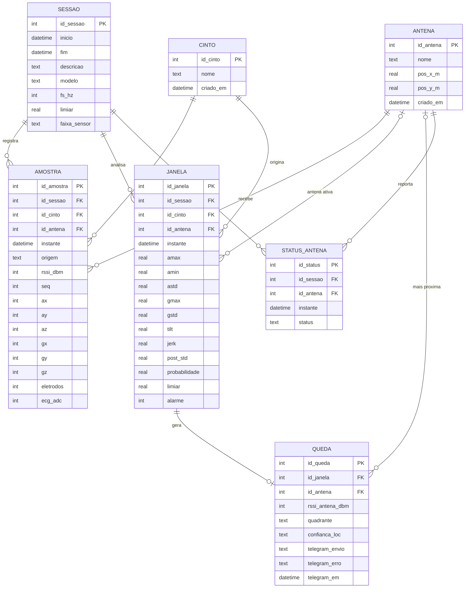

# Banco de Dados do Cinto Inteligente

## 1. Objetivo e escolha do SGBD

O sistema recebe, via MQTT, pacotes das antenas (ESP32) com leituras do cinto (acelerômetro, giroscópio, ECG, RSSI), analisa janelas de 2,5 s com um modelo Random Forest e gera alertas de possível queda. O banco de dados persiste esses dados para consulta após o encerramento do painel, exportação por sessão e evidência experimental (calibração de RSSI, autonomia de bateria, histórico de alertas).

**SGBD escolhido: SQLite 3**, por ser relacional, embarcado em um único arquivo (`dados/oqpnb.db`), sem servidor, nativo do Python e suficiente para o volume do MVP. O arquivo pode ser aberto em qualquer ferramenta SQLite (DB Browser, DBeaver, `sqlite3`). A implementação está em `banco.py`; a integração com o painel em `app.py` (classe `Conexao`).

Decisões de projeto:

- Instantes gravados em **UTC, ISO 8601** (`YYYY-MM-DDTHH:MM:SS.mmm+00:00`); o painel apresenta no horário local.
- Probabilidade e limiar armazenados no intervalo **0–1**; a porcentagem é apenas apresentação.
- Pacotes de *advertising* não trazem sensores: seus campos ficam **NULL**, nunca zero.
- Credenciais do Telegram (token, chat) **não** são armazenadas; grava-se apenas o resultado do envio.
- A tabela `queda` representa uma **possível queda detectada pelo sistema**, não um evento confirmado por pessoa.
- `seq` (contador do cinto) não é chave: repete entre antenas e reinicia a cada 65536.

## 2. Especificação dos dados armazenados

| Conjunto | Origem | Quando é gravado |
|---|---|---|
| Cintos e antenas | identificadores dos pacotes e geometria configurada | ao serem vistos pela primeira vez |
| Sessão de monitoramento | abertura do painel | ao conectar; fechada ao encerrar |
| Amostras brutas (100 Hz GATT + anúncios) | pacotes MQTT | **somente com "Gravar amostras" ativo** (volume: ~360 mil linhas/h por cinto) |
| Janelas analisadas (8 características + probabilidade) | detector | sempre (2 por segundo por cinto) |
| Quedas detectadas (local, antena, envio Telegram) | detector + localização + Telegram | sempre, uma por janela com alarme |
| Status das antenas (online/offline) | tópico MQTT `.../status` | sempre |

## 3. Modelo conceitual (DER)



Cardinalidades: uma sessão tem muitas amostras, janelas e status; um cinto tem muitas amostras e janelas; uma antena recebe muitas amostras; **uma janela gera no máximo uma queda** (1:0..1, garantido por `UNIQUE (id_janela)` em `queda`).

## 4. Modelo lógico

Notação: **PK** chave primária, **FK** chave estrangeira, sublinhado = obrigatório.

- **cinto** (<u>id_cinto</u> PK, <u>nome</u>, <u>criado_em</u>)
- **antena** (<u>id_antena</u> PK, <u>nome</u>, pos_x_m, pos_y_m, <u>criado_em</u>)
- **sessao** (<u>id_sessao</u> PK, <u>inicio</u>, fim, descricao, modelo, fs_hz, limiar, faixa_sensor)
- **amostra** (<u>id_amostra</u> PK, <u>id_sessao</u> FK→sessao, <u>id_cinto</u> FK→cinto, <u>id_antena</u> FK→antena, <u>instante</u>, <u>origem</u>, <u>rssi_dbm</u>, seq, ax, ay, az, gx, gy, gz, eletrodos, ecg_adc)
- **janela** (<u>id_janela</u> PK, <u>id_sessao</u> FK→sessao, <u>id_cinto</u> FK→cinto, id_antena FK→antena, <u>instante</u>, <u>amax</u>, <u>amin</u>, <u>astd</u>, <u>gmax</u>, <u>gstd</u>, <u>tilt</u>, <u>jerk</u>, <u>post_std</u>, <u>probabilidade</u>, <u>limiar</u>, <u>alarme</u>)
- **queda** (<u>id_queda</u> PK, <u>id_janela</u> FK→janela UNIQUE, id_antena FK→antena, rssi_antena_dbm, quadrante, confianca_loc, <u>telegram_envio</u>, telegram_erro, telegram_em)
- **status_antena** (<u>id_status</u> PK, <u>id_sessao</u> FK→sessao, <u>id_antena</u> FK→antena, <u>instante</u>, <u>status</u>)

Normalização: as tabelas estão na 3FN. Cinto e antena são entidades próprias para evitar repetir nome/posição em cada amostra; a queda referencia a janela em vez de copiar probabilidade e características; a sessão concentra os parâmetros do modelo que valem para todas as janelas daquele período.

## 5. Modelo físico (SQLite)

DDL completa em `banco.py` (constante `SCHEMA`). Resumo das restrições:

```sql
PRAGMA foreign_keys = ON;

CREATE TABLE cinto (
    id_cinto  INTEGER PRIMARY KEY CHECK (id_cinto > 0),
    nome      TEXT NOT NULL UNIQUE,
    criado_em TEXT NOT NULL);

CREATE TABLE antena (
    id_antena INTEGER PRIMARY KEY CHECK (id_antena > 0),
    nome      TEXT NOT NULL UNIQUE,
    pos_x_m   REAL CHECK (pos_x_m IS NULL OR pos_x_m >= 0),
    pos_y_m   REAL CHECK (pos_y_m IS NULL OR pos_y_m >= 0),
    criado_em TEXT NOT NULL);

CREATE TABLE sessao (
    id_sessao    INTEGER PRIMARY KEY AUTOINCREMENT,
    inicio       TEXT NOT NULL,
    fim          TEXT CHECK (fim IS NULL OR fim >= inicio),
    descricao    TEXT, modelo TEXT,
    fs_hz        INTEGER CHECK (fs_hz IS NULL OR fs_hz > 0),
    limiar       REAL CHECK (limiar IS NULL OR (limiar BETWEEN 0 AND 1)),
    faixa_sensor TEXT);

CREATE TABLE amostra (
    id_amostra INTEGER PRIMARY KEY AUTOINCREMENT,
    id_sessao  INTEGER NOT NULL REFERENCES sessao(id_sessao),
    id_cinto   INTEGER NOT NULL REFERENCES cinto(id_cinto),
    id_antena  INTEGER NOT NULL REFERENCES antena(id_antena),
    instante   TEXT NOT NULL,
    origem     TEXT NOT NULL CHECK (origem IN ('gatt', 'advertising')),
    rssi_dbm   INTEGER NOT NULL CHECK (rssi_dbm BETWEEN -127 AND 20),
    seq        INTEGER CHECK (seq IS NULL OR seq BETWEEN 0 AND 65535),
    ax INTEGER, ay INTEGER, az INTEGER, gx INTEGER, gy INTEGER, gz INTEGER,
    eletrodos  INTEGER CHECK (eletrodos IS NULL OR eletrodos IN (0, 1)),
    ecg_adc    INTEGER CHECK (ecg_adc IS NULL OR ecg_adc BETWEEN 0 AND 4095),
    CHECK (origem = 'gatt' OR (ax IS NULL AND gx IS NULL AND ecg_adc IS NULL)));
CREATE INDEX ix_amostra_sessao_instante ON amostra (id_sessao, instante);
CREATE INDEX ix_amostra_cinto_antena    ON amostra (id_cinto, id_antena, instante);

CREATE TABLE janela (
    id_janela  INTEGER PRIMARY KEY AUTOINCREMENT,
    id_sessao  INTEGER NOT NULL REFERENCES sessao(id_sessao),
    id_cinto   INTEGER NOT NULL REFERENCES cinto(id_cinto),
    id_antena  INTEGER REFERENCES antena(id_antena),
    instante   TEXT NOT NULL,
    amax REAL NOT NULL CHECK (amax >= 0),  amin REAL NOT NULL CHECK (amin >= 0),
    astd REAL NOT NULL CHECK (astd >= 0),  gmax REAL NOT NULL CHECK (gmax >= 0),
    gstd REAL NOT NULL CHECK (gstd >= 0),  tilt REAL NOT NULL CHECK (tilt BETWEEN 0 AND 180),
    jerk REAL NOT NULL CHECK (jerk >= 0),  post_std REAL NOT NULL CHECK (post_std >= 0),
    probabilidade REAL NOT NULL CHECK (probabilidade BETWEEN 0 AND 1),
    limiar        REAL NOT NULL CHECK (limiar BETWEEN 0 AND 1),
    alarme        INTEGER NOT NULL CHECK (alarme IN (0, 1)));
CREATE INDEX ix_janela_sessao_instante ON janela (id_sessao, instante);
CREATE INDEX ix_janela_cinto_instante  ON janela (id_cinto, instante);

CREATE TABLE queda (
    id_queda        INTEGER PRIMARY KEY AUTOINCREMENT,
    id_janela       INTEGER NOT NULL UNIQUE REFERENCES janela(id_janela),
    id_antena       INTEGER REFERENCES antena(id_antena),
    rssi_antena_dbm INTEGER CHECK (rssi_antena_dbm IS NULL OR rssi_antena_dbm BETWEEN -127 AND 20),
    quadrante       TEXT CHECK (quadrante IS NULL OR quadrante IN ('SE','SD','IE','ID')),
    confianca_loc   TEXT CHECK (confianca_loc IS NULL OR confianca_loc IN ('boa','baixa')),
    telegram_envio  TEXT NOT NULL DEFAULT 'nao_solicitado'
                    CHECK (telegram_envio IN ('nao_solicitado','pendente','enviado','falhou','cancelado')),
    telegram_erro   TEXT, telegram_em TEXT);

CREATE TABLE status_antena (
    id_status INTEGER PRIMARY KEY AUTOINCREMENT,
    id_sessao INTEGER NOT NULL REFERENCES sessao(id_sessao),
    id_antena INTEGER NOT NULL REFERENCES antena(id_antena),
    instante  TEXT NOT NULL,
    status    TEXT NOT NULL CHECK (status IN ('online','offline')));
CREATE INDEX ix_status_antena ON status_antena (id_antena, instante);
```

Configuração física: `journal_mode = WAL` (leituras do painel não bloqueiam a escrita), `synchronous = NORMAL`, escrita em lotes de até 500 linhas por transação por uma thread dedicada (o callback MQTT nunca espera o disco). Índices cobrem as consultas do painel (por sessão e instante; por cinto/antena para calibração de RSSI).

## 6. Dicionário de dados

### cinto
| Atributo | Tipo | Domínio / restrição | Descrição |
|---|---|---|---|
| id_cinto | INTEGER | PK, > 0 | Identificador enviado no pacote (`id_cinto`) |
| nome | TEXT | NOT NULL, único | Nome de exibição (ex.: `OQPNB01`) |
| criado_em | TEXT | NOT NULL, UTC ISO 8601 | Primeira vez que foi visto |

### antena
| Atributo | Tipo | Domínio / restrição | Descrição |
|---|---|---|---|
| id_antena | INTEGER | PK, > 0 | Identificador da anchor (`ID_ANTENA` do firmware) |
| nome | TEXT | NOT NULL, único | Ex.: `Anchor 1` |
| pos_x_m, pos_y_m | REAL | NULL ou ≥ 0 | Posição no ambiente (m), conforme `localizacao.ANCHORS` |
| criado_em | TEXT | NOT NULL | Primeira vez que foi vista |

### sessao
| Atributo | Tipo | Domínio / restrição | Descrição |
|---|---|---|---|
| id_sessao | INTEGER | PK autoincremento | Período de monitoramento (uma por conexão do painel) |
| inicio / fim | TEXT | fim NULL enquanto aberta; fim ≥ inicio | Instantes UTC |
| descricao | TEXT | livre | Observação do ensaio |
| modelo | TEXT | nome do arquivo | Ex.: `modelo_mvp_8g.joblib` |
| fs_hz | INTEGER | > 0 | Taxa de amostragem usada pelo detector |
| limiar | REAL | 0–1 | Limiar de alarme vigente na abertura |
| faixa_sensor | TEXT | livre | Ex.: `100 Hz, ±8 g / ±2000 °/s` |

### amostra
| Atributo | Tipo | Domínio / restrição | Descrição |
|---|---|---|---|
| id_amostra | INTEGER | PK | |
| id_sessao, id_cinto, id_antena | INTEGER | FK, NOT NULL | Sessão, cinto emissor, antena receptora |
| instante | TEXT | NOT NULL, UTC | Recepção no PC |
| origem | TEXT | `gatt` ou `advertising` | Conexão de dados ou anúncio BLE |
| rssi_dbm | INTEGER | −127 a 20 | Intensidade do sinal medida pela antena |
| seq | INTEGER | NULL ou 0–65535 | Contador do cinto (detecção de perdas) |
| ax, ay, az | INTEGER | int16 bruto do MPU6050 | Aceleração (LSB; ±8 g → 4096 LSB/g); NULL em advertising |
| gx, gy, gz | INTEGER | int16 bruto | Giro (LSB; ±2000 °/s → 16,4 LSB/(°/s)); NULL em advertising |
| eletrodos | INTEGER | NULL, 0 (solto) ou 1 (conectado) | Detecção de eletrodo do AD8232 |
| ecg_adc | INTEGER | NULL ou 0–4095 | Leitura bruta do ADC do ECG |

### janela
| Atributo | Tipo | Domínio / restrição | Descrição |
|---|---|---|---|
| id_janela | INTEGER | PK | |
| id_sessao, id_cinto | INTEGER | FK, NOT NULL | |
| id_antena | INTEGER | FK, NULL permitido | Antena com melhor RSSI no fechamento da janela |
| instante | TEXT | NOT NULL, UTC | Fim da janela de 2,5 s |
| amax, amin, astd | REAL | ≥ 0 | Máx., mín. e desvio de \|a\| (g) |
| gmax, gstd | REAL | ≥ 0 | Máx. e desvio de \|ω\| (°/s) |
| tilt | REAL | 0–180 | Ângulo entre gravidade inicial e final (graus) |
| jerk | REAL | ≥ 0 | Máx. variação de \|a\| por segundo (g/s) |
| post_std | REAL | ≥ 0 | Desvio de \|a\| nos últimos 0,5 s |
| probabilidade | REAL | 0–1 | Saída do Random Forest |
| limiar | REAL | 0–1 | Limiar aplicado nesta janela |
| alarme | INTEGER | 0 ou 1 | 1 se probabilidade ≥ limiar e fora do intervalo de silêncio |

### queda
| Atributo | Tipo | Domínio / restrição | Descrição |
|---|---|---|---|
| id_queda | INTEGER | PK | |
| id_janela | INTEGER | FK, NOT NULL, UNIQUE | Janela que gerou o alarme (1:1) |
| id_antena | INTEGER | FK, NULL permitido | Antena mais próxima no momento |
| rssi_antena_dbm | INTEGER | −127 a 20 | RSSI dessa antena |
| quadrante | TEXT | `SE`, `SD`, `IE`, `ID` ou NULL | Quadrante estimado; NULL = indisponível |
| confianca_loc | TEXT | `boa`, `baixa` ou NULL | Confiança qualitativa da localização |
| telegram_envio | TEXT | `nao_solicitado`, `pendente`, `enviado`, `falhou`, `cancelado` | Estado do alerta |
| telegram_erro | TEXT | livre | Motivo da falha (sem token) |
| telegram_em | TEXT | UTC | Instante do resultado do envio |

### status_antena
| Atributo | Tipo | Domínio / restrição | Descrição |
|---|---|---|---|
| id_status | INTEGER | PK | |
| id_sessao, id_antena | INTEGER | FK, NOT NULL | |
| instante | TEXT | NOT NULL, UTC | Recepção da mensagem de status |
| status | TEXT | `online` ou `offline` | Vindo do tópico MQTT `oqpnb/anchor/<n>/status` (LWT) |

## 7. Como o sistema utiliza o banco

1. **Abertura**: ao conectar ao broker, `Conexao` cria `Banco()`, cadastra as antenas da geometria e abre uma `sessao` com modelo, taxa e limiar.
2. **Recepção de pacote**: atualiza o estado em memória; se a gravação estiver ativa, enfileira uma `amostra` (sensores só em `gatt`).
3. **Janela fechada pelo detector**: grava `janela` de forma síncrona (precisa do `id_janela`); se houver alarme, grava `queda` com antena, quadrante e confiança da localização e `telegram_envio = 'pendente'` quando o envio está habilitado.
4. **Resultado do Telegram**: o callback atualiza `telegram_envio`, `telegram_erro` e `telegram_em` da queda correspondente.
5. **Status das antenas**: cada mensagem `online`/`offline` vira uma linha em `status_antena` (base para medir última comunicação em ensaios de autonomia).
6. **Exportação** (aba Detalhes): CSV de janelas, quedas, amostras e status **da sessão inteira**, lidos do banco, além do download do arquivo `.db`.
7. **Encerramento**: `fechar()` esvazia a fila, grava `sessao.fim` e fecha a conexão.

Consultas típicas:

```sql
-- quedas da sessão com contexto da janela
SELECT j.instante, c.nome, q.quadrante, j.probabilidade, q.telegram_envio
FROM queda q JOIN janela j ON j.id_janela = q.id_janela JOIN cinto c ON c.id_cinto = j.id_cinto
WHERE j.id_sessao = ? ORDER BY j.instante;

-- calibração RSSI: mediana por antena/origem em uma sessão de ensaio
SELECT id_antena, origem, COUNT(*), AVG(rssi_dbm)
FROM amostra WHERE id_sessao = ? GROUP BY id_antena, origem;

-- última comunicação de cada antena (autonomia)
SELECT id_antena, MAX(instante) FROM status_antena GROUP BY id_antena;
```

## 8. Limites e manutenção

- Amostras a 100 Hz crescem ~360 mil linhas/h por cinto (≈ 30–40 MB/h). Por isso só são persistidas com a gravação ligada; janelas e quedas são leves e ficam sempre.
- O arquivo pode ser arquivado por sessão (copiar `oqpnb.db`) ou limpo com `DELETE FROM amostra WHERE id_sessao = ?` seguido de `VACUUM`.
- Local do arquivo: variável de ambiente `OQPNB_DB` (padrão `dados/oqpnb.db` na pasta do projeto).
